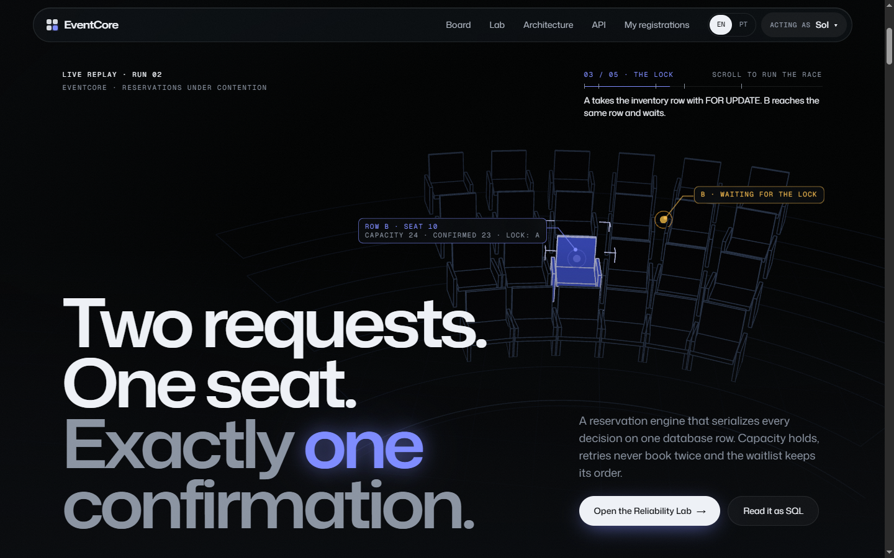
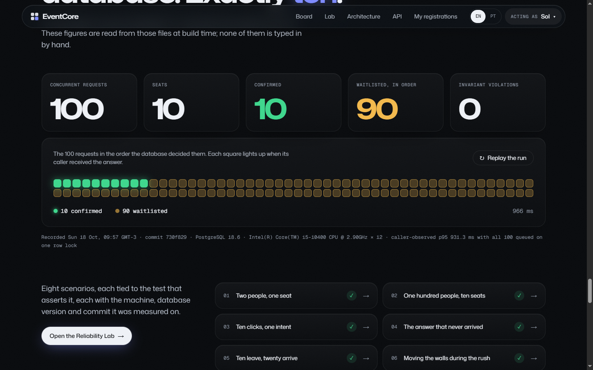
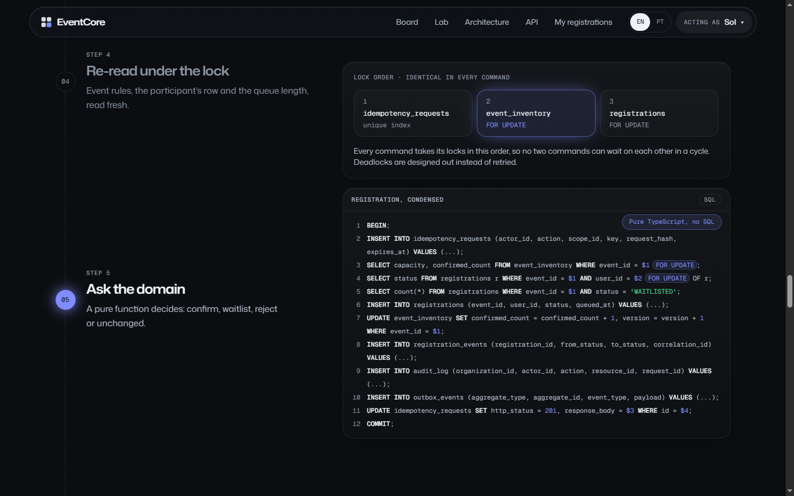
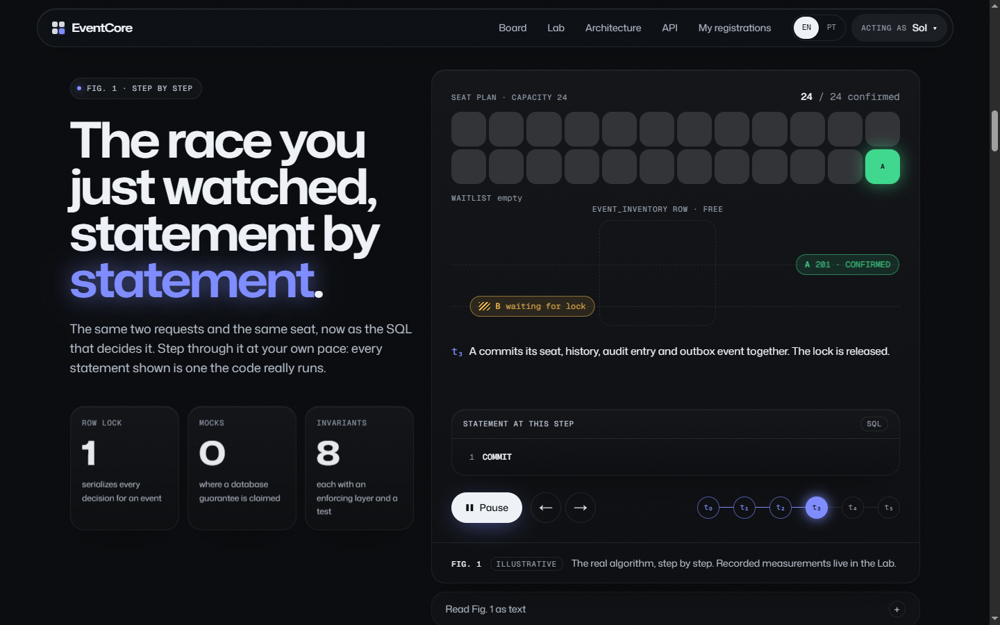
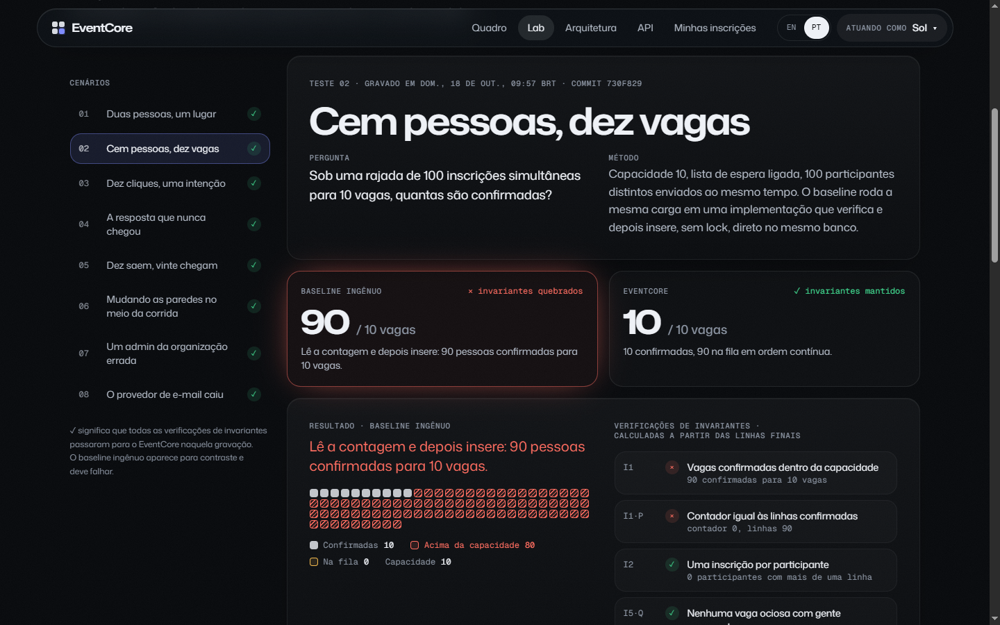
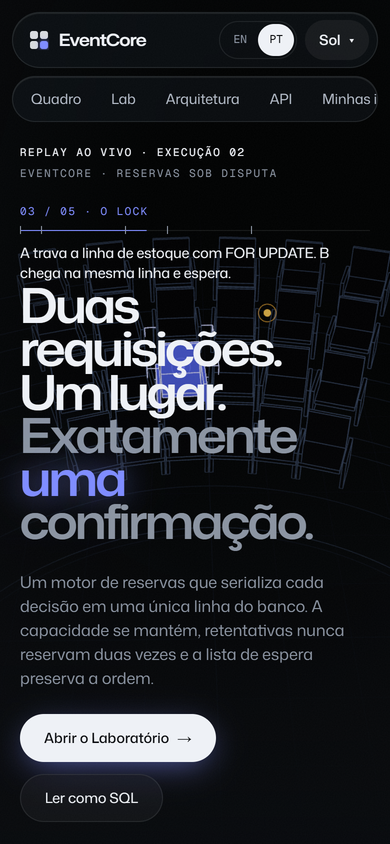

# EventCore

**Two requests. One seat. Exactly one confirmation.**

[Português (Brasil)](README.pt-BR.md)

**Live demo:** <https://eventcore-igor.vercel.app> · **API reference:** <https://eventcore-api.vercel.app/docs>

EventCore is a reservation engine for events with limited seats. Every decision for an event is serialized on a single PostgreSQL row, so capacity holds under concurrent load, retries never book twice, the waitlist keeps its order, and one organization can never see another's data. Each of those claims has a test that runs against a real database and a recorded run you can replay in the browser, in English or Portuguese.



## The result, recorded

Same load, same database, two implementations. 100 concurrent registrations for 10 seats:

| Implementation | Confirmed | Waitlisted | Invariant checks |
|---|---|---|---|
| Naive check-then-insert, no lock | **90 for 10 seats** | 0 | capacity ✗ · counter ✗ |
| EventCore | **10** | 90, positions 1–90 without gaps | all pass |



The other recorded scenarios, all passing every invariant check:

| # | Scenario | Outcome |
|---|---|---|
| 01 | Two people, one seat, then 30 more rounds | One confirmed, one first in line, in all 31 races |
| 03 | Ten identical clicks with one idempotency key | One decision, nine replays, one distinct answer |
| 04 | The server commits, the client never hears back, then retries | The retry gets the original confirmation, byte for byte |
| 05 | Ten cancellations race twenty newcomers | The first ten in line were promoted; no newcomer overtook the queue |
| 06 | Five capacity changes during a 60-person rush | Counter, rows and queue stay consistent; cuts below confirmed seats refused |
| 07 | An admin of the wrong organization probes six routes | All refused: 403 on their routes, 404 through ours; nothing changed |
| 08 | The notification provider is down | All registrations kept; four notifications delivered after recovery, none twice |

Recorded on 2026-10-07 at commit `321bed4` with `pnpm lab:record`: PostgreSQL 18.6, Node.js 24.12, Intel Core i5-10400, the real Fastify app driven in-process (no network hop), 40 pooled connections. Caller-observed p95 for the locked 100-request burst was 931 ms, because all 100 wait on one row lock and one pool. That is a single-machine measurement, not a production figure, and no throughput claim is made anywhere in this repository. The naive count varies between runs; it has never been 10.

## Run it

Requires Node.js 24, pnpm and Docker.

```bash
cp .env.example .env        # set AUTH_DEMO_SECRET to 32+ random characters
pnpm install
pnpm db:up && pnpm db:migrate && pnpm db:seed
pnpm dev                    # web on :3000, API on :4000, worker
```

Open <http://localhost:3000> (or <http://localhost:3000/pt-br>), choose a demo persona under **Acting as**, and race for *The Last Seat*. Swagger UI is at <http://localhost:4000/docs>.

```bash
pnpm test                   # 116 tests in 21 files, against a disposable PostgreSQL 18
pnpm test:e2e               # 11 Playwright tests: journeys, axe WCAG 2.2 AA, 360 px, keyboard
pnpm lab:record             # re-record the Lab; fails if a safe scenario breaks an invariant
```

## How it works

```
request ─ verify token ─ resolve membership ─ validate
        └─ BEGIN
           ├─ claim idempotency key        INSERT … ON CONFLICT DO NOTHING
           ├─ lock event_inventory          SELECT … FOR UPDATE
           ├─ re-read rules, row and queue  under the lock
           ├─ decide                        pure domain function
           ├─ write row, counter, history, audit entry, outbox event
           └─ store the answer on the key ─ COMMIT
        └─ worker relays the outbox, at least once, deduplicated
```



| Decision | Why | Record |
|---|---|---|
| Modular monolith | The hard rule is one synchronous decision; splitting it would turn a transaction into a protocol. | [ADR 0001](docs/adr/0001-modular-monolith.md) |
| Row lock on `event_inventory` under `READ COMMITTED` | Expresses "a queue exists, so a newcomer waits" atomically; no retry storms; FIFO kept. `SKIP LOCKED` is used only for the outbox. | [ADR 0002](docs/adr/0002-postgres-capacity-lock.md) |
| Idempotency key committed with the effect | A concurrent duplicate waits on the unique index and reads the committed answer; nothing to poll. | [ADR 0003](docs/adr/0003-idempotency-contract.md) |
| Transactional outbox | The notification exists only if the change does; delivery is retried and deduplicated. | [ADR 0004](docs/adr/0004-transactional-outbox.md) |

The eight invariants (I1–I8), each with the layer that enforces it and the test that tries to break it, are in [`docs/00-vision.md`](docs/00-vision.md) and on the landing page.

## The web experience

The site opens inside a small hall rendered with three.js: 24 seats drawn as a hidden-line model, one glowing seat left, and two requests racing for it as you scroll. The lock closes around the seat like a CAD selection box, one request is confirmed, the other drops into the queue. Everything after the hall stays in that same light: glass surfaces, Mona Sans at expanded widths, one glowing keyword per headline, and motion only where a recorded fact can be replayed. A sticky walkthrough highlights the SQL of each transaction step, the 100 recorded requests light up in the order the database decided them, and the Lab replays every run with its timings.

| | |
|---|---|
|  |  |

The research behind the design (measured CSS of Linear, Raycast, Resend, Basement, Clerk, Lusion and earlier Awwwards winners), the concept and the design system are in [`docs/experience`](docs/experience) and [`DESIGN.md`](DESIGN.md). On the production build the full landing scrolls at 142.6 fps on a 144 Hz display with no frame over 33 ms, and with 4× CPU throttling keeps p99 under 28 ms; Lighthouse reports 100 for accessibility, best practices and SEO. Every measurement and every defect found along the way is in [`docs/experience/09-validation.md`](docs/experience/09-validation.md).



## Two languages

English is served at the root and Brazilian Portuguese under `/pt-br`, from the same routes. The Portuguese dictionary is typed against the English one, recorded Lab sentences are translated by pattern so measured numbers survive a re-recording, and tests keep both in step. See [`docs/localization.md`](docs/localization.md).

## Repository

```
apps/
  api/        Fastify 5 · application services, HTTP adapters, problem details, metrics
  worker/     Outbox relay, backoff, dead letters, integrity sweep
  web/        Next.js 16 · React 19 · Tailwind 4 · three.js · the hall, the Lab, en and pt-BR
packages/
  domain/     Rules and transition tables, with no framework, ORM or driver imports
  contracts/  Zod schemas shared by API, web and the Lab recorder
  db/         Drizzle schema, reviewed SQL migrations, explicit-SQL repositories
  auth/       JWT verification and demo-token signing
tests/        Integration, concurrency, security, resilience, e2e, Lab recorder, k6 script
docs/         Vision, ADRs, state machine, data model, threat model, runbooks, localization, experience
infra/        Docker Compose and the API and worker images
```

## Known limits

- One very hot event serializes on one row lock. That bound is deliberate, measurable and documented.
- Rate limits are per process until a shared store is configured.
- The Lab replays recorded runs from one machine; it never sends traffic.
- The public demo runs the API as Vercel Functions, so rate limits and `/metrics` are per instance and the worker does not run there ([ADR 0005](docs/adr/0005-public-demo-on-serverless.md)).
- The k6 load script in [`tests/load`](tests/load) has not been run against a deployed environment, so there are no load results to report.

## Documentation

[Vision](docs/00-vision.md) · [State machine](docs/domain-state-machine.md) · [Data model](docs/data-model.md) · [API contract](docs/api-contract.md) · [Threat model](docs/threat-model.md) · [Testing methodology](docs/testing-methodology.md) · [Runbooks](docs/runbooks.md) · [Deployment](docs/deployment.md) · [Localization](docs/localization.md) · [Design system](DESIGN.md) · [Contributing](CONTRIBUTING.md) · [Security](SECURITY.md) · [Changelog](CHANGELOG.md)

## License

[MIT](LICENSE) © 2026 Igor Felipe
