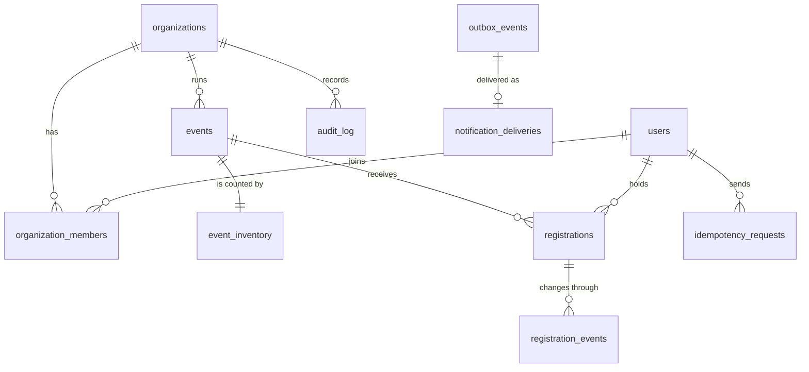

# Data model

Source of truth: `packages/db/src/schema.ts`. Generated, hand-reviewed SQL: `packages/db/migrations`. Primary keys are `uuidv7()` (PostgreSQL 18), so ids are time-ordered and index-friendly.

## Tables and the rules they carry

| Table | Key constraints | Why |
|---|---|---|
| `users` | `UNIQUE(external_auth_id)` | The provider subject is never the primary key; the internal id is. Only a display name is stored. |
| `organizations` | `UNIQUE(slug)` | Public address. |
| `organization_members` | `UNIQUE(organization_id, user_id)`, role enum | One role per person per organization. |
| `events` | `UNIQUE(organization_id, slug)`; `CHECK opens < closes ≤ starts` | The enrollment window is valid in the database, not only in the form. |
| `event_inventory` | `CHECK capacity ≥ 0`, `CHECK confirmed_count ≥ 0`, `CHECK confirmed_count ≤ capacity` | The single row every capacity decision locks. Separate from `events` so that metadata reads and edits never contend with registrations. |
| `registrations` | `UNIQUE(event_id, user_id)`; `CHECK (status = 'WAITLISTED') = (queued_at IS NOT NULL)` | One logical registration per participant. A queue position cannot exist without the waitlisted status and vice versa. |
| `registration_events` | append-only | Every transition with the request id that caused it. |
| `idempotency_requests` | `UNIQUE(actor_id, action, scope_id, key)` | The scoped key; stores status and body for replays. |
| `audit_log` | index `(organization_id, created_at DESC, id DESC)` | Registration entries hold ids and states. Event entries also hold the event's own fields: slug, capacity and schedule on creation, and on edits the changed name, description, venue and dates. Those are organization content; no entry holds participant data. |
| `outbox_events` | partial index on `(next_attempt_at, created_at)` where pending | Cheap polling of due events. |
| `notification_deliveries` | `UNIQUE(outbox_event_id)` | Deduplicated delivery. |

## Indexes that serve a specific query

| Index | Query |
|---|---|
| `registrations (event_id, status, queued_at, id)` | Head of the queue, queue length, queue position. |
| `events (status, starts_at, id)` | Public listing with keyset pagination. |
| `events (organization_id, starts_at)` | Organizer listing. |
| `idempotency_requests (expires_at)` | Purging expired keys. |

## The counter is a projection

`event_inventory.confirmed_count` duplicates information that exists in `registrations`. It is kept because it gives the lock a single row and lets the `CHECK` constraints work. It is maintained in the same transaction as every status change, and `readIntegrity` recomputes it from the rows so that the tests, the integrity endpoint, the Prometheus gauge and the worker sweep can detect drift.
