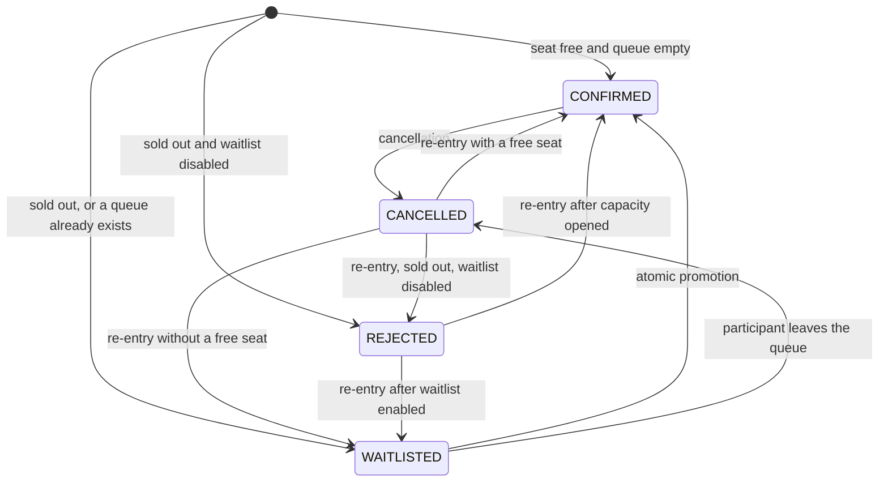
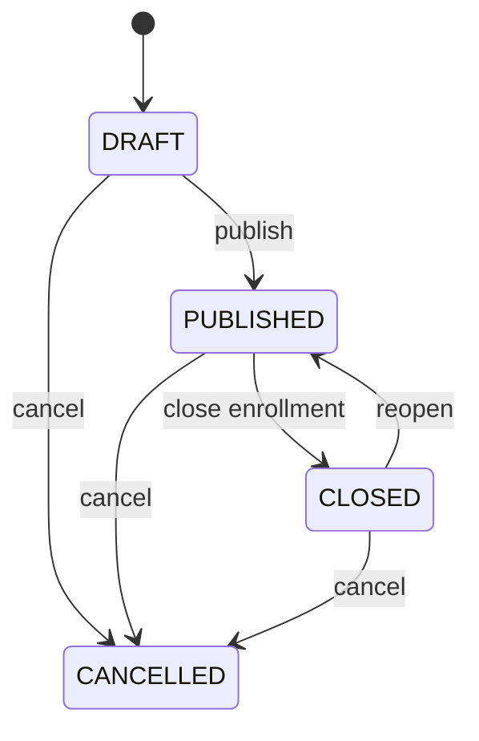

# Domain state machine

EventCore has two lifecycles: the **event** an organizer publishes and the **registration** a participant holds. Every state change goes through an explicit transition table in `packages/domain`. There is no code path that writes a status column without first asking the domain whether the transition is legal.

## Registration lifecycle

| From | To | Trigger | Counter effect |
|---|---|---|---|
| — | `CONFIRMED` | `RegisterForEvent`, seat free, queue empty | `confirmed_count + 1` |
| — | `WAITLISTED` | `RegisterForEvent`, sold out or queue not empty | none |
| — | `REJECTED` | `RegisterForEvent`, sold out, waitlist disabled | none |
| `WAITLISTED` | `CONFIRMED` | `PromoteWaitlist` (inside cancel or capacity change) | `confirmed_count + 1` |
| `WAITLISTED` | `CANCELLED` | `CancelRegistration` | none |
| `CONFIRMED` | `CANCELLED` | `CancelRegistration` | `confirmed_count - 1`, then promotion |
| `CANCELLED` / `REJECTED` | `CONFIRMED` / `WAITLISTED` | `RegisterForEvent` again | as above |
| `CANCELLED` | `REJECTED` | `RegisterForEvent` again, sold out, waitlist disabled | none |

A registration that is already `CONFIRMED` or `WAITLISTED` and receives a new registration request is **not** duplicated. The command returns the current state with transition `UNCHANGED`. A `REJECTED` registration that is rejected again is also `UNCHANGED`.

The transition table is asserted verbatim by `packages/domain/test/lifecycle.test.ts`, so this document and the code cannot drift apart silently.

### No idle seat while someone waits

The property test in `packages/domain/test/invariants.property.test.ts` runs 500 seeded random sequences of `register`, `cancel` and `changeCapacity` and asserts after every command that:

- `0 <= confirmed <= capacity` (I1),
- the confirmed counter equals the number of `CONFIRMED` rows (I2 projection),
- whenever the queue is not empty, the event is full (a seat is never left idle while someone waits, which is what I5 needs to be meaningful).

### Waitlist order

The queue is ordered by `(queued_at, id)`. `queued_at` is written every time a registration **enters** `WAITLISTED`. Ordering by the row's original `created_at` would let a participant who cancelled and re-entered jump ahead of people who queued in the meantime; `queued_at` closes that gap.

## Event lifecycle

| Transition | Allowed roles | Notes |
|---|---|---|
| `DRAFT → PUBLISHED` | `ADMIN`, `ORGANIZER` | Requires a valid enrollment window. |
| `PUBLISHED → CLOSED` | `ADMIN`, `ORGANIZER` | Existing registrations are kept. |
| `CLOSED → PUBLISHED` | `ADMIN` | Re-entry still respects the existing queue. |
| `* → CANCELLED` | `ADMIN` | Terminal. |

## Rules

1. Registrations are accepted only for `PUBLISHED` events inside the enrollment window.
2. Capacity can never be set below `confirmed_count`.
3. A new registration never overtakes an existing queue.
4. Cancelling a confirmed seat releases it and promotes the head of the queue **in the same transaction**.
5. Increasing capacity promotes from the head of the queue in the same transaction, in a bounded batch.
6. History rows are never physically deleted by normal flows.
7. Every command that touches capacity or the queue acquires the inventory row lock **first**, in the same order, so all commands for one event are serialized and lock ordering cannot deadlock.
