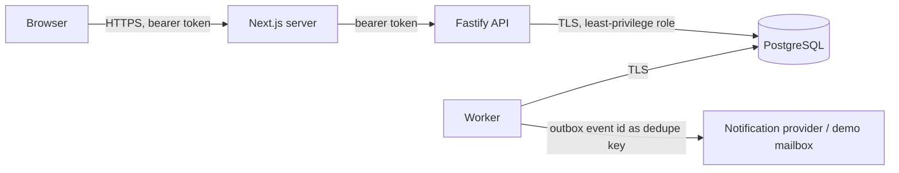

# Threat model

Scope: the API, the worker, the PostgreSQL database and the public demo. Method: STRIDE per trust boundary, mapped to OWASP API Security Top 10 (2023) and OWASP ASVS 5.0 V8 (authorization).

## Trust boundaries

Everything to the left of the API is untrusted input. The API trusts only the verified token subject and what it reads from the database itself.

## Threats and controls

| ID | Threat | OWASP | Control | Evidence |
|---|---|---|---|---|
| T1 | An organizer changes an id in the URL to read or modify another organization (BOLA/IDOR). | API1, ASVS V8.2 | Membership is resolved for the organization **in the path** before any work; every query also filters by that organization id, so a foreign event id is "not found". | `tests/security/tenant-isolation.test.ts` |
| T2 | A participant cancels someone else's registration by guessing its id. | API1 | Only the owner or an admin of the event's organization may cancel; everyone else gets `404`, so ids cannot be probed. | `tests/concurrency/waitlist.test.ts` |
| T3 | Identity spoofing through request fields (`userId`, `organizationId`, `role`). | API3, ASVS V8.3 | The actor comes from the verified token only. Registration bodies are `.strict()`; other bodies drop unknown keys. | `tenant-isolation.test.ts` "smuggled fields" |
| T4 | Forged or replayed tokens. | API2 | Signature, issuer, audience, `exp` and `iat` are verified. Demo-signed tokens are restricted to the `demo|` namespace; provider tokens may not claim it. | `packages/auth/test/token-verifier.test.ts` |
| T5 | Overbooking through concurrent requests (business-logic race). | API6 | Inventory row lock, consistent lock order, database `CHECK` constraints and an integrity sweep. | `tests/concurrency/*` |
| T6 | Duplicate effects through retries or replays. | API6 | Scoped idempotency keys committed with the effect. | `tests/http/idempotency.test.ts` |
| T7 | Resource exhaustion and brute force. | API4 | Per-IP global rate limit, stricter limit on registration, 16 KiB body limit, page size capped at 100, statement timeout of 5 s. | `tests/http/operations.test.ts` |
| T8 | Information disclosure through errors. | API8 | One error handler; problem documents never contain stack traces, SQL or PII. Unknown failures become `INTERNAL_ERROR` with a request id. | `tests/http/identity.test.ts` |
| T9 | PII leaking into logs, audit or outbox. | ASVS V14 | Logs redact `authorization`, cookies and idempotency keys. Audit and outbox rows carry ids and states only; display names are resolved at read time. | `tests/http/audit-trail.test.ts` |
| T10 | Abuse of the public demo (load, real data). | API4 | The Lab replays recorded runs and never sends traffic. Seeds contain fictional personas only. Demo signing exists only where `AUTH_DEMO_SECRET` is configured. | `docs/runbooks.md` |
| T11 | Lost notifications or notifications for rolled-back changes. | — | Transactional outbox; at-least-once delivery with deduplication by event id; dead letters kept. | `tests/resilience/outbox.test.ts` |

## Residual risks

- **Single-event hot spot.** A malicious burst against one event serializes on one row lock. Rate limiting reduces it; it does not remove it.
- **Rate limiting is per process.** Multiple API replicas each keep their own counters until a shared store is configured.
- **Metrics endpoint.** `/metrics` is open unless `METRICS_TOKEN` is set. Production deployments must set it or keep the endpoint on a private network.
- **Demo signing key.** Anyone holding `AUTH_DEMO_SECRET` can act as any demo persona. It must never be configured in an environment that holds real data.

## Data protection (LGPD)

The schema stores a display name and an opaque external subject per user. No email, phone or document number is stored in the MVP. History rows are never physically deleted by normal flows; erasure requests are handled by pseudonymizing `users.display_name` and `external_auth_id`, which keeps the integrity of capacity history without keeping identity.
